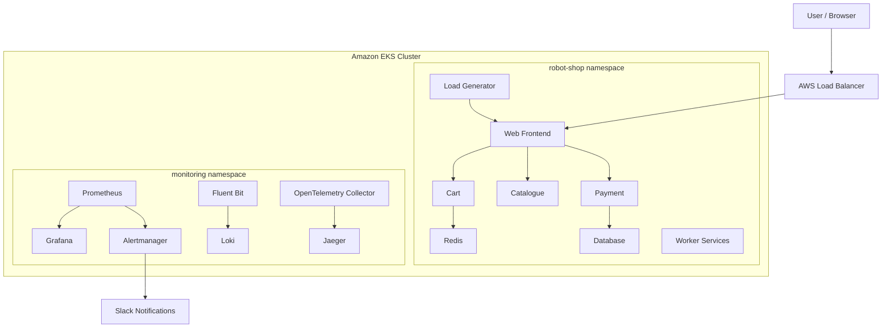

# Stan's Robot Shop — Kubernetes Deployment & Observability on AWS EKS

<p align="center">
  <strong>A Cloud-Native Microservices Application with Monitoring, Logging, Distributed Tracing, SLOs and Incident Response</strong>
</p>

<p align="center">
  
  
  
  
  
  
  
</p>

---

## Table of Contents

- [Project Overview](#project-overview)
- [Project Objectives](#project-objectives)
- [Application Overview](#application-overview)
- [Architecture](#architecture)
- [Technology Stack](#technology-stack)
- [Infrastructure and Deployment](#infrastructure-and-deployment)
- [Prerequisites](#prerequisites)
- [Deploying the Application](#deploying-the-application)
- [Accessing the Application](#accessing-the-application)
- [Monitoring and Observability](#monitoring-and-observability)
  - [Prometheus](#1-prometheus--metrics)
  - [Grafana](#2-grafana--visualization)
  - [Fluent Bit and Loki](#3-fluent-bit--loki-logging)
  - [OpenTelemetry and Jaeger](#4-opentelemetry--jaeger-tracing)
- [Service Level Objectives and Error Budgets](#service-level-objectives-and-error-budgets)
- [Alerting and Slack Integration](#alerting-and-slack-integration)
- [Incident Management and Recovery](#incident-management-and-recovery)
- [Runbook and Documentation](#runbook-and-documentation)
- [Load Generation](#load-generation)
- [Original Application Documentation](#original-application-documentation)
- [Lessons Learned](#lessons-learned)
- [Future Improvements](#future-improvements)
- [Disclaimer](#disclaimer)

---

## Project Overview

Stan's Robot Shop is a sample microservices application designed to provide a practical environment for learning containerization, orchestration, and application monitoring.

This project extends the original Robot Shop application into a cloud-native deployment on **Amazon Elastic Kubernetes Service (Amazon EKS)**.

The objective is not simply to deploy an application, but to build and operate an observable microservices environment with monitoring, centralized logging, distributed tracing, service availability objectives, alerting, and incident response procedures.

The application is deployed to Kubernetes using Helm, while a dedicated observability stack provides visibility into application health and operational performance.

The project demonstrates practical DevOps and Site Reliability Engineering (SRE) concepts, including:

- Container orchestration with Kubernetes.
- Application deployment and management using Helm.
- Metrics collection and visualization.
- Centralized log aggregation and querying.
- Distributed tracing across microservices.
- Service Level Objectives (SLOs).
- Error budget management.
- Alerting and incident response.
- Failure simulation, service recovery, and post-incident documentation.

## Project Objectives

The project focuses on six primary objectives:

| # | Objective | Implementation |
|---|---|---|
| 1 | Application deployment | Deploy Robot Shop and load generator to AWS EKS using Helm |
| 2 | Metrics monitoring | Prometheus and Grafana dashboards |
| 3 | Centralized logging | Fluent Bit and Loki |
| 4 | Distributed tracing | OpenTelemetry and Jaeger |
| 5 | Reliability management | SLOs, error budgets, and Slack notifications |
| 6 | Incident response | Failure injection, recovery, root cause analysis, and postmortems |

---

## Application Overview

Stan's Robot Shop is a sample microservices application that simulates an online robot store.

It consists of multiple independently deployed services communicating to deliver the application's functionality.

The original application uses several technologies:

- Node.js and Express
- Java and Spring Boot
- Python and Flask
- Golang
- PHP and Apache
- MongoDB
- Redis
- MySQL
- RabbitMQ
- Nginx
- AngularJS

The application is intended as a sandbox for learning microservices architecture and container orchestration. It is not a comprehensive reference implementation of production-grade application security or error handling.

For additional background, see the original [Stan's Robot Shop blog post](https://www.instana.com/blog/stans-robot-shop-sample-microservice-application/).

---

## Architecture

The environment is divided into two primary Kubernetes namespaces:

- `robot-shop` — application workloads.
- `monitoring` — monitoring and observability components.

### High-Level Architecture



### Observability Data Flow

| Component | Responsibility |
|---|---|
| Prometheus | Collects and stores metrics |
| Grafana | Visualizes metrics through dashboards |
| Fluent Bit | Collects container logs from Kubernetes nodes |
| Loki | Stores and indexes logs for querying |
| OpenTelemetry Collector | Receives and forwards telemetry data |
| Jaeger | Stores and visualizes distributed traces |
| Alertmanager | Routes Prometheus alerts to notification channels |
| Slack | Receives operational alert notifications |

---

## Technology Stack

| Category | Technology |
|---|---|
| Cloud Provider | Amazon Web Services |
| Kubernetes Platform | Amazon EKS |
| Container Runtime | Docker / containerd |
| Package Management | Helm |
| Application | Stan's Robot Shop |
| Metrics Collection | Prometheus |
| Visualization | Grafana |
| Log Collection | Fluent Bit |
| Log Aggregation | Loki |
| Distributed Tracing | OpenTelemetry |
| Trace Visualization | Jaeger |
| Alert Management | Alertmanager |
| Notifications | Slack |
| Load Generation | Locust |
| Operating System | Ubuntu 22.04 |

---

## Infrastructure and Deployment

The application runs on Amazon EKS in the `eu-north-1` AWS region.

### Kubernetes Namespaces

```bash
kubectl get namespaces
```

The project uses:

```text
robot-shop
monitoring
```

### Verify Application Workloads

```bash
kubectl get pods -n robot-shop
kubectl get services -n robot-shop
kubectl get deployments -n robot-shop
```

### Verify Monitoring Workloads

```bash
kubectl get pods -n monitoring
kubectl get services -n monitoring
kubectl get deployments -n monitoring
```

### Helm Releases

```bash
helm list -A
```

Helm is used to install and manage the Robot Shop application and the monitoring stack.

### Deployment Configuration

The Robot Shop application is deployed using its Helm chart:

```bash
helm install robot-shop ./helm/robot-shop -n robot-shop --create-namespace
```

> Adjust the chart path and release name if your local chart directory differs.

The monitoring stack is deployed using the `kube-prometheus-stack` Helm chart.

The project uses the release name `prom-stack` in the `monitoring` namespace.

To inspect releases:

```bash
helm list -A
```

To inspect deployment history:

```bash
helm history robot-shop -n robot-shop
```

---

## Prerequisites

Before deploying the project, ensure the following tools are installed and configured:

- AWS CLI
- kubectl
- Helm
- Docker
- An AWS account with permissions to manage EKS resources
- A configured Kubernetes context pointing to the EKS cluster

Verify the installations:

```bash
aws --version
kubectl version --client
helm version
docker --version
```

Configure access to an existing EKS cluster:

```bash
aws eks update-kubeconfig \
  --region eu-north-1 \
  --name <EKS_CLUSTER_NAME>
```

Verify cluster connectivity:

```bash
kubectl get nodes
```

---

## Deploying the Application

### 1. Deploy Robot Shop

Install the application using Helm:

```bash
helm install robot-shop ./helm/robot-shop \
  -n robot-shop --create-namespace
```

If the release already exists, inspect it before making changes:

```bash
helm status robot-shop -n robot-shop
```

### 2. Deploy the Load Generator

The load generator is provided separately and can be deployed to Kubernetes to generate application traffic.

Verify its deployment:

```bash
kubectl get pods -n robot-shop
```

### 3. Verify Application Health

```bash
kubectl get pods -n robot-shop -o wide
```

Check deployment readiness:

```bash
kubectl get deployments -n robot-shop
```

Check services:

```bash
kubectl get svc -n robot-shop
```

---

## Accessing the Application

The web frontend is exposed through an AWS LoadBalancer service.

Retrieve the external endpoint:

```bash
kubectl get svc web -n robot-shop
```

Get the LoadBalancer hostname:

```bash
kubectl get svc web -n robot-shop \
  -o jsonpath='{.status.loadBalancer.ingress[0].hostname}'
```

Open the returned endpoint in a browser using the service's exposed port.

The endpoint can change if the Kubernetes service or AWS LoadBalancer is recreated.

---

# Monitoring and Observability

Observability is a central part of this project. The monitoring stack provides insight into application health, performance, logs, and distributed request execution.

## 1. Prometheus — Metrics

Prometheus is used to collect and store metrics from the Kubernetes cluster and application components.

The project uses `kube-prometheus-stack` to provide the Prometheus monitoring infrastructure.

Prometheus is configured to scrape metrics from monitored targets, including the Nginx Prometheus exporter deployed for the Robot Shop web frontend.

### Nginx Exporter

The Nginx Prometheus exporter exposes metrics from the web frontend's Nginx status endpoint.

The exporter provides metrics such as:

- Total HTTP requests.
- Active connections.
- Accepted connections.
- Handled connections.
- Nginx exporter health.

Example Prometheus metric:

```promql
rate(nginx_http_requests_total[5m])
```

This query calculates the average rate of HTTP requests over the previous five minutes.

### Verify Metrics Collection

```bash
kubectl get pods -n robot-shop
kubectl get svc nginx-exporter -n robot-shop
kubectl get servicemonitor -n robot-shop
```

The exporter metrics endpoint is available on port `9113`.

---

## 2. Grafana — Visualization

Grafana provides dashboards for monitoring application and Kubernetes infrastructure performance.

The project includes two dashboards:

### Robot Shop - RED Metrics

The custom RED dashboard focuses on the application's request-oriented monitoring.

RED stands for:

- **Rate:** How frequently requests are being processed.
- **Errors:** How many requests are failing.
- **Duration:** How long requests take to complete.

The dashboard provides a view of request activity, errors, and latency where suitable metrics are available.

### Robot Shop Infrastructure Dashboard

The infrastructure dashboard provides visibility into:

- Network throughput.
- Container restarts.
- Pod health.
- CPU utilization.
- Memory working set.

### Access Grafana

Retrieve the Grafana LoadBalancer endpoint:

```bash
kubectl get svc -n monitoring
```

Find the Grafana service and open its external hostname in a browser.

Grafana credentials are managed through the Helm chart's configuration and Kubernetes secrets.

---

## 3. Fluent Bit and Loki — Logging

The project uses Fluent Bit to collect container logs from Kubernetes nodes and forward them to Loki.

### Log Collection Pipeline

```text
Kubernetes Containers
        |
        v
Fluent Bit DaemonSet
        |
        v
Loki
        |
        v
Grafana Explore
```

Fluent Bit runs as a DaemonSet so that container logs can be collected across the cluster nodes.

Loki stores the collected logs and makes them available for querying through Grafana.

### Verify Fluent Bit

```bash
kubectl get pods -n monitoring | grep fluent
```

### Verify Loki

```bash
kubectl get pods -n monitoring | grep loki
kubectl get svc loki -n monitoring
```

### Example LogQL Queries

Search for logs from the web service:

```logql
{service_name="web"}
```

Find errors in web service logs:

```logql
{service_name="web"} |= "Error"
```

Search payment service errors:

```logql
{service_name="payment"} |= "Error"
```

These queries can be executed in Grafana Explore with Loki selected as the data source.

---

## 4. OpenTelemetry and Jaeger — Tracing

Distributed tracing helps identify how requests travel through different microservices.

The project uses OpenTelemetry to receive and forward trace data to Jaeger.

### Tracing Pipeline

```text
Robot Shop Services
        |
        v
OpenTelemetry Collector
        |
        v
Jaeger
        |
        v
Trace Visualization
```

### Example Trace

A checkout request can be inspected in Jaeger:

```text
web: POST /api/cart/checkout
    |
    +---- catalogue
    |
    +---- cart
    |
    +---- payment
```

The trace provides visibility into the request's execution path, individual service spans, and request duration.

This helps identify which service contributes to latency or failures during a request.

### Verify Tracing Components

```bash
kubectl get pods -n monitoring
kubectl get svc -n monitoring
```

Open the Jaeger LoadBalancer endpoint in a browser to explore available traces.

---

# Service Level Objectives and Error Budgets

Site Reliability Engineering practices are used to define and manage the availability expectations of the application's critical services.

The project establishes availability SLOs for the Web and Payment services.

## Availability Objectives

| Service | Availability SLO | Error Budget |
|---|---:|---:|
| Web | 99.0% | 1.0% |
| Payment | 99.5% | 0.5% |

The objectives are defined over a rolling 30-day measurement window.

### Error Budget Calculation

A 30-day period contains 43,200 minutes.

| Service | Allowed Downtime |
|---|---:|
| Web | 432 minutes |
| Payment | 216 minutes |

The error budget represents the amount of unavailability that can occur before the service violates its availability objective.

### Availability Formula

```text
Availability (%) =
(Successful Requests / Total Valid Requests) × 100
```

### Error Budget Policy

**Healthy error budget**
- Continue normal development and deployment activities.
- Monitor service availability and performance.

**Low error budget**
- Investigate recurring failures.
- Review deployments and configuration changes.
- Prioritize reliability improvements.

**Exhausted error budget**
- Pause non-essential feature releases.
- Prioritize reliability and bug fixes.
- Investigate the root cause.
- Resume normal releases after stability has been reviewed.

The detailed policy is documented in:

`SLO_ERROR_BUDGET_POLICY.md`

> The configured availability alerts detect service pod readiness and unavailability. The request-based availability formula describes the intended SLI; it should not be interpreted as a claim that request-level availability is currently calculated by those pod-readiness alert rules.

---

# Alerting and Slack Integration

Prometheus alerting rules monitor the availability of the Web and Payment services.

Alertmanager routes notifications to the Slack `#monitoring` channel.

### Configured SLO Alerts

| Alert | Service | SLO | Severity |
|---|---|---:|---|
| RobotShopWebAvailabilitySLOBreached | Web | 99.0% | Critical |
| RobotShopPaymentAvailabilitySLOBreached | Payment | 99.5% | Critical |

### Alert Response Workflow

```text
Service Failure
      |
      v
Prometheus Alert Rule
      |
      v
Alertmanager
      |
      v
Slack #monitoring
      |
      v
Incident Investigation
      |
      v
Service Recovery
      |
      v
Resolved Notification
```

When a monitored service becomes unavailable or unready, Prometheus evaluates the alert rule and Alertmanager sends a notification to Slack.

After recovery, the alert can transition to resolved.

---

# Incident Management and Recovery

A key part of this project is demonstrating how to respond to application failures rather than simply monitoring healthy services.

Controlled failure injection was performed against the Web and Payment services.

## Incident 1 — Web Service Failure

**Failure scenario:** An invalid container image was deployed to the Web service.

### Failure Injection

```bash
kubectl set image deployment/web \
  web=robotshop/rs-web:bad-image \
  -n robot-shop
```

### Observed Impact

The Kubernetes deployment attempted to pull an invalid image.

The affected pod entered an image-pull failure state, preventing the Web service from becoming ready.

The availability alert was triggered and a critical notification was delivered to Slack.

### Recovery

The deployment was restored to its working image:

```bash
kubectl set image deployment/web \
  web=robotshop/rs-web:latest \
  -n robot-shop
```

Verify recovery:

```bash
kubectl rollout status deployment/web -n robot-shop
kubectl get pods -n robot-shop
```

The Web deployment returned to a healthy state, and the alert was resolved.

## Incident 2 — Payment Service Failure

**Failure scenario:** An invalid container image was deployed to the Payment service.

### Failure Injection

```bash
kubectl set image deployment/payment \
  payment=robotshop/rs-payment:bad-image \
  -n robot-shop
```

### Observed Impact

The Payment deployment could not pull the invalid image.

The service became unavailable, triggering the Payment availability alert.

A critical notification was delivered to Slack.

### Recovery

Restore the working image:

```bash
kubectl set image deployment/payment \
  payment=robotshop/rs-payment:latest \
  -n robot-shop
```

Verify recovery:

```bash
kubectl rollout status deployment/payment -n robot-shop
kubectl get pods -n robot-shop
```

The Payment deployment returned to a healthy state and Alertmanager delivered a resolved notification.

## Incident Response Summary

| Incident | Failure Injected | Detection | Recovery |
|---|---|---|---|
| Web | Invalid container image | Prometheus and Slack | Restored working image |
| Payment | Invalid container image | Prometheus and Slack | Restored working image |

Both incidents demonstrated:

- Failure detection through Kubernetes monitoring.
- Automated alert notifications.
- Investigation of failed deployments.
- Recovery through Kubernetes deployment updates.
- Verification of application health.
- Alert resolution after recovery.

### Post-Incident Documentation

A postmortem was prepared for the Web service incident.

It documents:

- Incident summary.
- Customer impact.
- Incident timeline.
- Root cause analysis.
- Recovery actions.
- Corrective and preventive measures.

The postmortem is available in:

`postmortem.md`

---

# Runbook and Documentation

Operational documentation is maintained alongside the project.

| Document | Description |
|---|---|
| `RUNBOOK.md` | Operational procedures for Web and Payment service alerts |
| `SLO_ERROR_BUDGET_POLICY.md` | Availability objectives and error budget policy |
| `postmortem.md` | Incident analysis and lessons learned |

The runbook provides practical commands for diagnosing service availability problems, investigating failures, and restoring affected workloads.

---

# Load Generation

A separate load-generation utility is provided in the original Robot Shop project.

The load generator is built using Python and Locust.

It can be used to generate traffic against the application and observe how the services behave under load.

### Run with Docker Compose

To start the application locally:

```bash
docker-compose pull
docker-compose up
```

To start the application together with the load generator:

```bash
docker-compose -f docker-compose.yaml \
  -f docker-compose-load.yaml up
```

### Load Generator on Kubernetes

The load generator can also be deployed within Kubernetes.

Inspect its workload:

```bash
kubectl get pods -n robot-shop
```

For additional instructions, see the original [Load Generator README](load-gen/README.md).

---

# Original Application Documentation

The original Stan's Robot Shop project supports additional deployment and instrumentation approaches.

### Build from Source

To build the Docker images from source, configure the required environment variables and run:

```bash
export INSTANA_AGENT_KEY="<your-agent-key>"
docker-compose build
```

If you have changed the image registry or tag in the `.env` file, you can push the images using:

```bash
docker-compose push
```

### Run Locally

The application can be run locally using Docker Compose:

```bash
docker-compose pull
docker-compose up
```

The local frontend is available at:

`http://localhost:8080`

### Kubernetes

The original application includes Kubernetes deployment manifests and Helm chart documentation.

See the original [Kubernetes Helm README](K8s/helm/README.md).

### DC/OS / Marathon

The original DC/OS manifests are located in the `DCOS/` directory.

### Website and End-User Monitoring

The original project supports Instana Website Monitoring and End-User Monitoring.

See the [Instana Website Monitoring documentation](https://docs.instana.io/website_monitoring/).

### Original Prometheus Metrics

The original Robot Shop application also provides Prometheus metric endpoints for the Cart and Payment services.

Example endpoints:

```bash
curl http://<host>:8080/api/cart/metrics
curl http://<host>:8080/api/payment/metrics
```

The Cart service provides a counter for the number of items added to the cart.

The Payment service provides:
- A counter of purchased items.
- A histogram of the number of items in each cart.
- A histogram of the total value of each cart.

---

# Lessons Learned

This project provided practical experience with several important DevOps and SRE concepts.

### Kubernetes and Helm
- Deploying and managing microservices on AWS EKS.
- Managing application resources through Helm.
- Inspecting pod, deployment, and service health.
- Recovering failed deployments.

### Monitoring
- Deploying Prometheus and Grafana.
- Configuring metrics exporters and ServiceMonitors.
- Building dashboards for application and infrastructure visibility.

### Logging
- Running Fluent Bit as a DaemonSet.
- Forwarding Kubernetes container logs to Loki.
- Querying application logs through Grafana.

### Distributed Tracing
- Understanding trace and span relationships.
- Using OpenTelemetry Collector to forward trace data.
- Investigating service execution paths with Jaeger.

### Site Reliability Engineering
- Defining availability objectives.
- Calculating error budgets.
- Configuring availability alerts.
- Delivering alerts through Slack.
- Performing controlled failure injection.
- Recovering failed services and documenting incidents.

---

# Future Improvements

Potential improvements for a future iteration include:

- Implement request-level availability SLIs using application metrics.
- Add HTTP error-rate and latency histogram instrumentation.
- Introduce automated deployment pipelines using CI/CD.
- Use immutable container image tags instead of relying on `latest`.
- Implement automated rollback strategies.
- Introduce Kubernetes admission policies to prevent invalid image deployments.
- Add resource requests, limits, and autoscaling policies.
- Strengthen application security and secret management.
- Expand SLO monitoring with multi-window, multi-burn-rate alerting.

---

# Disclaimer

Stan's Robot Shop is a sample microservices application intended for learning and experimentation. The original application does not provide comprehensive security controls or production-grade error handling.

This project demonstrates deployment, observability, reliability engineering, and incident response practices in a learning environment. Additional hardening and validation would be required before using the environment for production workloads.

---

## Acknowledgements

- Original application: [Stan's Robot Shop](https://github.com/instana/robot-shop)
- Original application documentation: [Instana Blog](https://www.instana.com/blog/stans-robot-shop-sample-microservice-application/)
- Kubernetes: [Official Documentation](https://kubernetes.io/docs/)
- Amazon EKS: [AWS Documentation](https://docs.aws.amazon.com/eks/)
- Helm: [Official Documentation](https://helm.sh/docs/)
- Prometheus: [Official Documentation](https://prometheus.io/docs/)
- Grafana: [Official Documentation](https://grafana.com/docs/)
- Loki: [Official Documentation](https://grafana.com/docs/loki/)
- OpenTelemetry: [Official Documentation](https://opentelemetry.io/docs/)
- Jaeger: [Official Documentation](https://www.jaegertracing.io/docs/)

---

<p align="center">
  <strong>Built as a hands-on DevOps and Site Reliability Engineering project.</strong>
</p>
