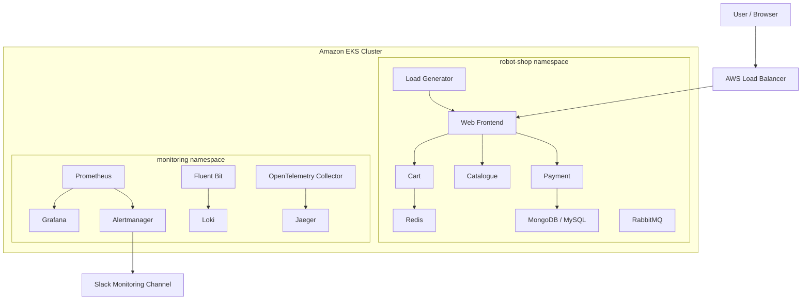
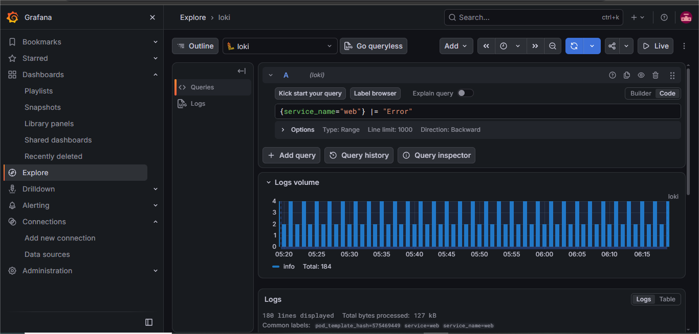
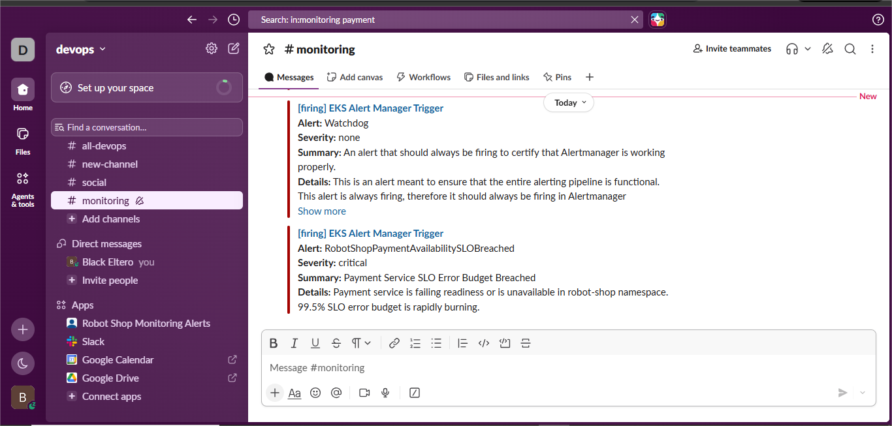
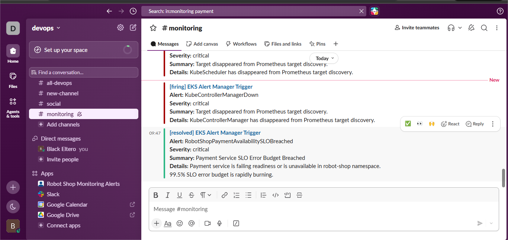

# Stan's Robot Shop — AWS EKS Deployment, Monitoring & Observability

<p align="center">
  <strong>A Cloud-Native Microservices Deployment with Kubernetes, Prometheus, Grafana, Loki, Jaeger and SRE Practices</strong>
</p>

<p align="center">
  
  
  
  
  
  
  
</p>

---

## Table of Contents

1. [Project Overview](#1-project-overview)
2. [Project Objectives](#2-project-objectives)
3. [Application Overview](#3-application-overview)
4. [Architecture](#4-architecture)
5. [Technology Stack](#5-technology-stack)
6. [Repository Structure](#6-repository-structure)
7. [Infrastructure and Deployment](#7-infrastructure-and-deployment)
8. [Application Access](#8-application-access)
9. [Monitoring and Observability](#9-monitoring-and-observability)
10. [Service Level Objectives and Error Budgets](#10-service-level-objectives-and-error-budgets)
11. [Alerting and Slack Integration](#11-alerting-and-slack-integration)
12. [Incident Management and Recovery](#12-incident-management-and-recovery)
13. [Operational Documentation](#13-operational-documentation)
14. [Original Robot Shop Features](#14-original-robot-shop-features)
15. [Lessons Learned](#15-lessons-learned)
16. [Future Improvements](#16-future-improvements)
17. [Disclaimer](#17-disclaimer)
18. [Acknowledgements](#18-acknowledgements)

---

# 1. Project Overview

Stan's Robot Shop is a sample microservices application designed to provide a practical environment for learning containerization, orchestration, and application monitoring.

This project extends the original Robot Shop application into a cloud-native environment deployed on **Amazon Elastic Kubernetes Service (Amazon EKS)**.

The goal is not simply to deploy an application, but to build and operate an observable microservices environment with:

- Kubernetes orchestration and Helm-based deployments.
- Application and infrastructure monitoring.
- Centralized log collection and analysis.
- Distributed tracing across microservices.
- Service Level Objectives (SLOs).
- Error budget management.
- Automated alerting and Slack notifications.
- Failure injection and incident recovery.
- Incident documentation and postmortem analysis.

The project demonstrates practical DevOps and Site Reliability Engineering (SRE) concepts through the deployment, monitoring, troubleshooting, and recovery of a distributed application.

# 2. Project Objectives

The project addresses six primary objectives:

| # | Objective | Implementation |
|---|---|---|
| 1 | Application deployment | Deploy Robot Shop and load generator to AWS EKS |
| 2 | Metrics monitoring | Prometheus and Grafana dashboards |
| 3 | Centralized logging | Fluent Bit and Loki |
| 4 | Distributed tracing | OpenTelemetry and Jaeger |
| 5 | Reliability management | SLOs, error budgets and Slack alerts |
| 6 | Incident response | Failure injection, mitigation, recovery and postmortems |

# 3. Application Overview

Stan's Robot Shop simulates an online robot store using independently deployed microservices.

The original application uses technologies including:

- Node.js and Express
- Java and Spring Boot
- Python and Flask
- Golang
- PHP and Apache
- MongoDB
- Redis
- MySQL
- RabbitMQ
- Nginx
- AngularJS

The application provides an environment for experimenting with microservices architecture, containerization, and orchestration.

For additional background, see the original [Stan's Robot Shop blog post](https://www.instana.com/blog/stans-robot-shop-sample-microservice-application/).

# 4. Architecture

The project runs on Amazon EKS and separates application workloads from observability components using Kubernetes namespaces.

| Namespace | Purpose |
|---|---|
| `robot-shop` | Robot Shop application services and load generator |
| `monitoring` | Metrics, dashboards, logging, tracing and alerting |

## High-Level Architecture



## Observability Data Flow

| Component | Responsibility |
|---|---|
| Prometheus | Collects and stores metrics |
| Grafana | Visualizes metrics through dashboards |
| Fluent Bit | Collects Kubernetes container logs |
| Loki | Stores and makes logs searchable |
| OpenTelemetry Collector | Receives and forwards telemetry data |
| Jaeger | Stores and visualizes distributed traces |
| Alertmanager | Routes Prometheus alerts |
| Slack | Receives operational alert notifications |

# 5. Technology Stack

| Category | Technology |
|---|---|
| Cloud Provider | Amazon Web Services |
| Kubernetes Platform | Amazon EKS |
| Container Runtime | containerd |
| Containerization | Docker |
| Package Management | Helm |
| Application | Stan's Robot Shop |
| Metrics Collection | Prometheus |
| Visualization | Grafana |
| Log Collection | Fluent Bit |
| Log Aggregation | Loki |
| Distributed Tracing | OpenTelemetry |
| Trace Visualization | Jaeger |
| Alert Management | Alertmanager |
| Notifications | Slack |
| Load Generation | Locust |
| Operating System | Ubuntu 22.04 |

# 6. Repository Structure

The repository contains the Kubernetes deployment configuration, monitoring configuration, operational documentation, and project evidence.

```text
devops_capstone2/
│
├── K8s/
│   └── helm/
│       └── robot-shop/
│
├── monitoring/
│   ├── alert/
│   │   └── monitoring-values.yaml
│   └── ...
│
├── doc/
│   ├── fullydeployed(1).png
│   ├── redmetrics-dashboard(2).png
│   ├── red-metrics-prometheus(1).png
│   ├── loki-searc-by-service.png
│   ├── jaegerotl-trace(2).png
│   ├── service-breach-alert-to-slack(1).png
│   ├── payment-alert-firing.png
│   ├── payment-alert-resolved.png
│   └── incidentdrill-web(2).png
│
├── RUNBOOK.md
├── SLO_ERROR_BUDGET_POLICY.md
├── postmortem.md
└── README.md
```

*The structure above highlights the principal project files and evidence. Other application and Helm chart files are omitted for readability.*

# 7. Infrastructure and Deployment

The application is deployed to Amazon EKS in the `eu-north-1` AWS region.

Helm is used to install and manage the application and monitoring components.

## Prerequisites

- AWS account with appropriate EKS permissions.
- AWS CLI.
- kubectl.
- Helm.
- Docker.
- Configured access to an EKS cluster.

Verify the required tools:

```bash
aws --version
kubectl version --client
helm version
docker --version
```

Configure Kubernetes access:

```bash
aws eks update-kubeconfig \
  --region eu-north-1 \
  --name <EKS_CLUSTER_NAME>
```

Verify cluster connectivity:

```bash
kubectl get nodes
```

## Kubernetes Namespaces

```bash
kubectl get namespaces
```

The project uses:

- `robot-shop`
- `monitoring`

## Verify Application Workloads

```bash
kubectl get pods -n robot-shop
kubectl get deployments -n robot-shop
kubectl get services -n robot-shop
kubectl get pvc -n robot-shop
```

## Verify Monitoring Workloads

```bash
kubectl get pods -n monitoring
kubectl get services -n monitoring
kubectl get deployments -n monitoring
```

## Helm Releases

```bash
helm list -A
```

Inspect the Robot Shop release:

```bash
helm status robot-shop -n robot-shop
```

Inspect its deployment history:

```bash
helm history robot-shop -n robot-shop
```

## Deployment Evidence

The following screenshot shows the Robot Shop workloads and persistent storage in Kubernetes. It also demonstrates the recovery of pods from temporary startup states into healthy running workloads.


# 8. Application Access

The Robot Shop frontend is exposed through an AWS LoadBalancer service.

Retrieve the service:

```bash
kubectl get svc web -n robot-shop
```

Retrieve its external hostname:

```bash
kubectl get svc web -n robot-shop \
  -o jsonpath='{.status.loadBalancer.ingress[0].hostname}'
```

Open the returned LoadBalancer endpoint in a browser using the exposed service port.

The hostname may change if the Kubernetes service or AWS LoadBalancer is recreated.

# 9. Monitoring and Observability

Observability is a central part of this project.

The monitoring stack provides visibility into application activity, infrastructure health, application logs, and distributed request execution.

## 9.1 Prometheus — Metrics Collection

Prometheus collects and stores metrics from Kubernetes and monitored application components.

The project uses `kube-prometheus-stack` to provide the Prometheus monitoring infrastructure.

### Nginx Prometheus Exporter

An Nginx Prometheus exporter is deployed to expose metrics from the Robot Shop web frontend's Nginx status endpoint.

The exporter provides metrics such as:

- Total HTTP requests.
- Active connections.
- Accepted connections.
- Handled connections.
- Exporter health.

Example PromQL query:

```promql
rate(nginx_http_requests_total[5m])
```

This calculates the average request rate over the previous five minutes.

### Verify Exporter

```bash
kubectl get pods -n robot-shop
kubectl get svc nginx-exporter -n robot-shop
kubectl get servicemonitor -n robot-shop
```

The exporter exposes metrics on port `9113`.

### Prometheus Metrics Evidence

The following screenshot shows the Prometheus metrics used by the monitoring setup.


## 9.2 Grafana — Dashboards and Visualization

Grafana provides dashboards for monitoring application and infrastructure performance.

Two dashboards are included in the project.

### Robot Shop RED Metrics Dashboard

The custom RED dashboard follows the RED monitoring methodology:

- **Rate:** How frequently requests are processed.
- **Errors:** Request failures and error rates.
- **Duration:** How long requests take to complete.

The dashboard provides a visual overview of request activity, errors, and latency using the available metrics.

### Robot Shop Infrastructure Dashboard

The infrastructure dashboard provides visibility into:

- Network throughput.
- Container restarts.
- Pod health.
- CPU utilization.
- Memory working set.

### RED Dashboard Evidence


### Infrastructure Dashboard Evidence

The infrastructure dashboard complements the custom RED dashboard by showing the resource utilization and health of application workloads.

## 9.3 Fluent Bit and Loki — Centralized Logging

Fluent Bit collects container logs from Kubernetes nodes and forwards them to Loki.

### Logging Pipeline

```text
Kubernetes Containers
        |
        v
Fluent Bit DaemonSet
        |
        v
Loki
        |
        v
Grafana Explore
```

Fluent Bit runs as a DaemonSet, allowing it to collect container logs across cluster nodes.

Loki stores the collected logs and makes them available for querying through Grafana Explore.

### Verify Fluent Bit

```bash
kubectl get pods -n monitoring
```

### Verify Loki

```bash
kubectl get pods -n monitoring | grep loki
kubectl get svc loki -n monitoring
```

### Example LogQL Queries

View web service logs:

```logql
{service_name="web"}
```

Search web service logs for errors:

```logql
{service_name="web"} |= "Error"
```

Search payment service logs for errors:

```logql
{service_name="payment"} |= "Error"
```

### Loki Log Search Evidence

The following screenshot demonstrates querying application logs by service in Grafana Explore.



## 9.4 OpenTelemetry and Jaeger — Distributed Tracing

Distributed tracing provides visibility into how requests move through multiple microservices.

The project uses OpenTelemetry to receive and forward trace data to Jaeger.

### Tracing Pipeline

```text
Robot Shop Services
        |
        v
OpenTelemetry Collector
        |
        v
Jaeger
        |
        v
Trace Visualization
```

### Example Checkout Trace

A checkout request can be inspected in Jaeger:

```text
web: POST /api/cart/checkout
    |
    +---- catalogue
    |
    +---- cart
    |
    +---- payment
```

The trace provides visibility into:

- Request execution paths.
- Individual service spans.
- HTTP methods and routes.
- HTTP response status codes.
- Service execution duration.

This helps identify which services contribute to request latency or failures.

### Jaeger Trace Evidence

The screenshot below shows a checkout request and its child service spans across the Robot Shop application.


# 10. Service Level Objectives and Error Budgets

Site Reliability Engineering practices are used to define and manage availability expectations for critical application services.

The project establishes availability SLOs for the Web and Payment services.

## Availability Objectives

| Service | Availability SLO | Error Rate Budget |
|---|---:|---:|
| Web | 99.0% | 1.0% |
| Payment | 99.5% | 0.5% |

The objectives are defined over a rolling 30-day measurement window.

## Error Budget Calculation

A 30-day period contains 43,200 minutes.

| Service | Error Budget | Allowed Downtime |
|---|---:|---:|
| Web | 1.0% | 432 minutes |
| Payment | 0.5% | 216 minutes |

The error budget represents the amount of unavailability permitted before a service violates its availability objective.

### Availability Formula

```text
Availability (%) =
(Successful Requests / Total Valid Requests) × 100
```

### Error Budget Policy

**Healthy error budget**

- Continue normal development and deployment activities.
- Monitor service availability and performance.

**Low error budget**

- Investigate recurring failures.
- Review deployments and configuration changes.
- Prioritize reliability improvements.

**Exhausted error budget**

- Pause non-essential feature releases.
- Prioritize reliability improvements and bug fixes.
- Investigate the root cause.
- Resume normal releases after service stability has been reviewed.

The full policy is documented in [`SLO_ERROR_BUDGET_POLICY.md`](SLO_ERROR_BUDGET_POLICY.md).

> **Measurement note:** The configured availability alerts detect pod readiness and service unavailability. The request-based availability formula describes the intended SLI; it should not be interpreted as proof that request-level availability is currently calculated by those pod-readiness alert rules.

# 11. Alerting and Slack Integration

Prometheus alerting rules monitor the availability of the Web and Payment services.

Alertmanager routes notifications to the Slack `#monitoring` channel.

## Configured SLO Alerts

| Alert | Service | SLO | Severity |
|---|---|---:|---|
| RobotShopWebAvailabilitySLOBreached | Web | 99.0% | Critical |
| RobotShopPaymentAvailabilitySLOBreached | Payment | 99.5% | Critical |

## Alert Response Workflow

```text
Service Failure
      |
      v
Prometheus Alert Rule
      |
      v
Alertmanager
      |
      v
Slack #monitoring
      |
      v
Incident Investigation
      |
      v
Service Recovery
      |
      v
Resolved Notification
```

When a monitored service becomes unavailable or unready, Prometheus evaluates the configured alert rule.

Alertmanager then sends a notification to Slack.

After recovery, the alert transitions to resolved.

## Web Service Alert Evidence

The following screenshot demonstrates the Web service availability alert being delivered to Slack.


## Payment Service Alert Evidence

The following screenshot shows the Payment service SLO alert firing in Slack.



After the service was restored, Alertmanager delivered a resolved notification.



# 12. Incident Management and Recovery

A major objective of this project is demonstrating how to respond to application failures rather than simply monitoring healthy services.

Two controlled failure-injection exercises were performed against the Web and Payment services.

## Incident 1 — Web Service Failure

**Failure scenario:** An invalid container image was deployed to the Web service.

### Failure Injection

```bash
kubectl set image deployment/web \
  web=robotshop/rs-web:bad-image \
  -n robot-shop
```

### Observed Impact

Kubernetes attempted to pull an invalid image.

The affected pod entered `ErrImagePull` and `ImagePullBackOff` states, preventing the new deployment from becoming ready.

The Web availability alert fired and a critical notification was delivered to Slack.

### Recovery

The deployment was restored to its working image:

```bash
kubectl set image deployment/web \
  web=robotshop/rs-web:latest \
  -n robot-shop
```

Verify recovery:

```bash
kubectl rollout status deployment/web -n robot-shop
kubectl get pods -n robot-shop
```

The deployment successfully rolled out, the Web pod returned to a healthy state, and the alert was resolved.

### Web Incident Evidence

The screenshot below captures the invalid image deployment, the resulting image-pull failure, and the recovery to the working image.


## Incident 2 — Payment Service Failure

**Failure scenario:** An invalid container image was deployed to the Payment service.

### Failure Injection

```bash
kubectl set image deployment/payment \
  payment=robotshop/rs-payment:bad-image \
  -n robot-shop
```

### Observed Impact

The Payment deployment could not pull the invalid image.

The service became unavailable, triggering the Payment availability alert.

A critical notification was delivered to Slack.

### Recovery

Restore the working image:

```bash
kubectl set image deployment/payment \
  payment=robotshop/rs-payment:latest \
  -n robot-shop
```

Verify recovery:

```bash
kubectl rollout status deployment/payment -n robot-shop
kubectl get pods -n robot-shop
```

The Payment deployment returned to a healthy state, and Alertmanager delivered a resolved notification.

## Incident Response Summary

| Incident | Failure Injected | Detection | Recovery |
|---|---|---|---|
| Web | Invalid container image | Prometheus and Slack | Restored working image |
| Payment | Invalid container image | Prometheus and Slack | Restored working image |

Both incidents demonstrated:

- Failure detection through Kubernetes monitoring.
- Automated alert notifications.
- Investigation of failed deployments.
- Recovery through Kubernetes deployment updates.
- Verification of application health.
- Alert resolution after recovery.

# 13. Operational Documentation

The project includes operational documents to support troubleshooting, reliability management, and incident response.

| Document | Purpose |
|---|---|
| [`RUNBOOK.md`](RUNBOOK.md) | Operational procedures for Web and Payment service alerts |
| [`SLO_ERROR_BUDGET_POLICY.md`](SLO_ERROR_BUDGET_POLICY.md) | Availability objectives and error budget policy |
| [`postmortem.md`](postmortem.md) | Incident analysis, root cause and corrective actions |

The runbook contains practical commands for diagnosing service availability issues, investigating failures, and restoring affected workloads.

The postmortem records the Web incident, its impact, timeline, root cause, and preventive actions.

# 14. Original Robot Shop Features

The original Stan's Robot Shop project supports additional deployment and instrumentation approaches.

## Build from Source

To build the Docker images from source, configure the required environment variable:

```bash
export INSTANA_AGENT_KEY="<your-agent-key>"
```

Build the images:

```bash
docker-compose build
```

Push images if using an alternative registry:

```bash
docker-compose push
```

## Run Locally

Pull the application images:

```bash
docker-compose pull
```

Start the application:

```bash
docker-compose up
```

Start the application with load generation:

```bash
docker-compose -f docker-compose.yaml \
  -f docker-compose-load.yaml up
```

The local frontend is available at:

`http://localhost:8080`

## Original Kubernetes Deployment

The original application includes Kubernetes deployment manifests and Helm chart documentation.

See the original [Kubernetes Helm README](K8s/helm/README.md).

## DC/OS / Marathon

The original DC/OS manifests are available in the `DCOS/` directory.

## Website and End-User Monitoring

The original project supports Instana Website Monitoring and End-User Monitoring.

See the [Instana Website Monitoring documentation](https://docs.instana.io/website_monitoring/).

## Original Prometheus Metrics

The original Robot Shop application provides metric endpoints for the Cart and Payment services.

Example endpoints:

```bash
curl http://<host>:8080/api/cart/metrics
curl http://<host>:8080/api/payment/metrics
```

The Cart service provides a counter for the number of items added to the cart.

The Payment service provides:

- A counter of purchased items.
- A histogram of the number of items in each cart.
- A histogram of the total value of each cart.

For more information about the original application, visit the [Stan's Robot Shop GitHub repository](https://github.com/instana/robot-shop).

# 15. Lessons Learned

This project provided practical experience with several important DevOps and SRE concepts.

### Kubernetes and Helm

- Deploying and managing microservices on AWS EKS.
- Managing application resources through Helm.
- Inspecting pod, deployment, service and persistent volume health.
- Recovering failed deployments.

### Monitoring and Visualization

- Deploying Prometheus and Grafana.
- Configuring exporters and ServiceMonitors.
- Building dashboards for application and infrastructure visibility.

### Centralized Logging

- Running Fluent Bit as a DaemonSet.
- Forwarding Kubernetes container logs to Loki.
- Querying application logs through Grafana.

### Distributed Tracing

- Understanding trace and span relationships.
- Using OpenTelemetry Collector to forward trace data.
- Investigating service execution paths with Jaeger.

### Site Reliability Engineering

- Defining availability objectives.
- Calculating error budgets.
- Configuring availability alerts.
- Delivering alerts through Slack.
- Performing controlled failure injection.
- Recovering failed services.
- Documenting incidents and corrective actions.

# 16. Future Improvements

Potential improvements for a future iteration include:

- Implement request-level availability SLIs using application metrics.
- Add HTTP error-rate and latency histogram instrumentation.
- Introduce automated deployment pipelines using CI/CD.
- Use immutable container image tags instead of relying on `latest`.
- Implement automated rollback strategies.
- Introduce Kubernetes admission policies to prevent invalid image deployments.
- Add resource requests, limits, and autoscaling policies.
- Strengthen application security and secret management.
- Expand SLO monitoring with multi-window, multi-burn-rate alerting.

# 17. Disclaimer

Stan's Robot Shop is a sample microservices application intended for learning and experimentation.

The original application does not provide comprehensive security controls or production-grade error handling.

This project demonstrates deployment, observability, reliability engineering, and incident response practices in a learning environment. Additional security hardening, reliability validation, and operational testing would be required before using the environment for production workloads.

# 18. Acknowledgements

- Original application: [Stan's Robot Shop](https://github.com/instana/robot-shop)
- Original application documentation: [Instana Blog](https://www.instana.com/blog/stans-robot-shop-sample-microservice-application/)
- Kubernetes: [Official Documentation](https://kubernetes.io/docs/)
- Amazon EKS: [AWS Documentation](https://docs.aws.amazon.com/eks/)
- Helm: [Official Documentation](https://helm.sh/docs/)
- Prometheus: [Official Documentation](https://prometheus.io/docs/)
- Grafana: [Official Documentation](https://grafana.com/docs/)
- Loki: [Official Documentation](https://grafana.com/docs/loki/)
- OpenTelemetry: [Official Documentation](https://opentelemetry.io/docs/)
- Jaeger: [Official Documentation](https://www.jaegertracing.io/docs/)

---

<p align="center">
  <strong>Built as a hands-on DevOps and Site Reliability Engineering project.</strong>
</p>
